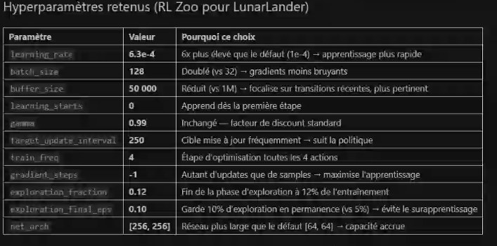
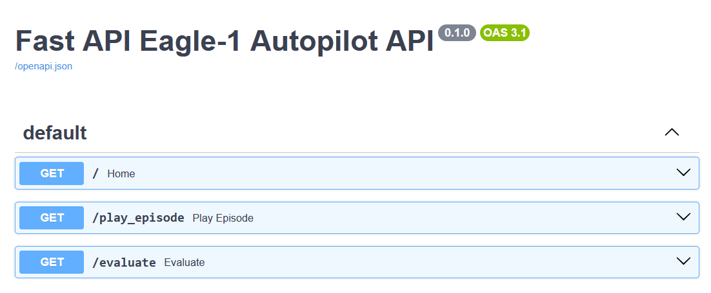
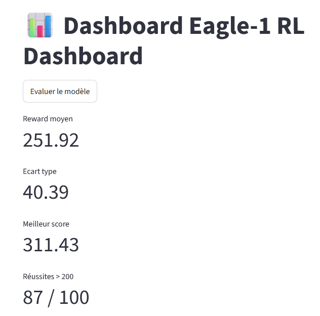
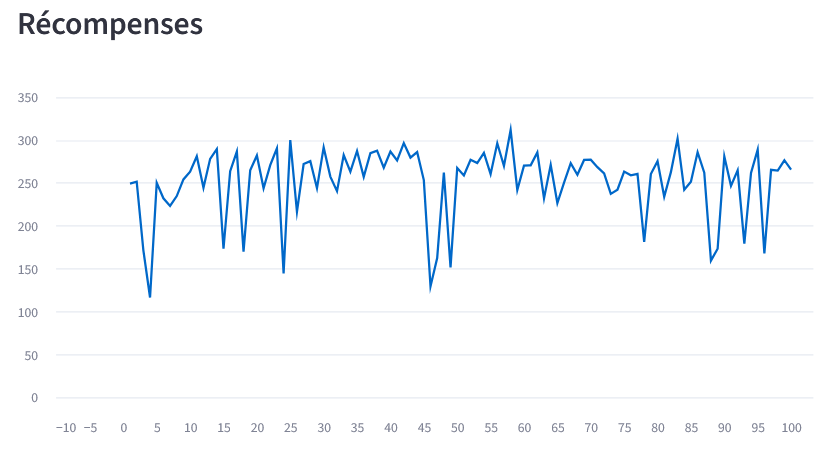
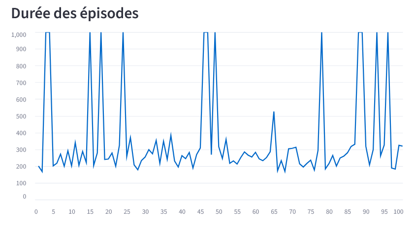

# Projet 11 — Introduction au Reinforcement Learning

Ce projet propose une première approche de l’apprentissage par renforcement
(Reinforcement Learning, ou RL).

Le notebook [`rl_book.ipynb`](./rl_book.ipynb) constitue une introduction
progressive aux notions essentielles :

- environnement, états, actions et récompenses ;
- découverte de l’environnement **CartPole** avec Gymnasium ;
- principe du Q-learning ;
- implémentation et entraînement d’un agent **DQN**, d’abord manuellement
  puis avec Stable-Baselines3.

D’autres notebooks et une partie projet viendront compléter cette introduction,
notamment autour de l’expérimentation, de l’optimisation et de l’évaluation des
modèles.

## Installation

Le projet utilise Python 3.11 ou 3.12. Avec [uv](https://docs.astral.sh/uv/) :

```bash
uv sync
```

Puis lancer Jupyter :

```bash
uv run jupyter notebook
```

## Objectif du projet

Le projet consiste à développer le pilote automatique du module
d'atterrissage **Eagle-1** dans l'environnement
[`LunarLander-v3`](https://gymnasium.farama.org/environments/box2d/lunar_lander/).
L'agent doit apprendre à atterrir de manière stable et précise sur la zone
cible.

L'objectif de performance retenu est une récompense moyenne supérieure à
**200 points**, évaluée sur 100 épisodes.

## Démarche expérimentale

Le notebook [`notebook_lunar.ipynb`](./notebook_lunar.ipynb) présente
l'ensemble de la démarche :

1. exploration des espaces d'observation et d'action de LunarLander-v3 ;
2. entraînement d'un premier modèle DQN servant de baseline ;
3. évaluation de la baseline avec les récompenses moyennes et leur dispersion ;
4. expérimentation des hyperparamètres, notamment le taux d'apprentissage,
   `gamma`, la taille du buffer, la taille des batchs et l'exploration ;
5. comparaison des expériences avec TensorBoard ;
6. recherche automatisée des paramètres avec Optuna ;
7. entraînement et évaluation du modèle final sur 100 épisodes ;
8. génération d'une vidéo d'une partie réussie.

Les modèles entraînés sont enregistrés dans [`model/`](./model/), les journaux
TensorBoard dans [`tensorboard_logs/`](./tensorboard_logs/) et les vidéos dans
[`videos/`](./videos/).



## Architecture de l'application

Le projet est organisé autour d'une API qui centralise la logique
d'inférence du modèle :

- [`main.py`](./main.py) — API FastAPI et chargement du modèle final ;
- [`app.py`](./app.py) — interface Streamlit pour lancer une partie et
  visualiser la vidéo produite ;
- [`dashboard.py`](./dashboard.py) — tableau de bord Streamlit pour évaluer
  le modèle et afficher les métriques ;
- [`model/dqn_lunarlander_final_3.zip`](./model/dqn_lunarlander_final_3.zip) —
  modèle DQN utilisé par l'API.

L'interface et le tableau de bord communiquent avec l'API ; ils ne contiennent
pas la logique d'apprentissage ou de décision du modèle.

## Lancer l'API

Depuis la racine du projet :

```bash
uv run uvicorn main:app --reload
```

L'API est alors accessible à l'adresse `http://127.0.0.1:8000`.

Endpoints disponibles :

- `GET /` — vérifie que le pilote Eagle-1 est en ligne ;
- `GET /play_episode` — joue un épisode, calcule sa récompense et enregistre
  une vidéo dans `videos/` ;
- `GET /evaluate` — évalue le modèle sur 100 épisodes et renvoie la
  récompense moyenne, l'écart-type, le meilleur score, le nombre de réussites
  au-dessus de 200 et le détail des épisodes.

La documentation interactive FastAPI est disponible sur
[`/docs`](http://127.0.0.1:8000/docs).



## Lancer les interfaces Streamlit

L'API doit être démarrée dans un premier terminal. Dans un second terminal,
lancer l'interface de démonstration :

```bash
uv run streamlit run app.py
```

Pour ouvrir le tableau de bord d'évaluation :

```bash
uv run streamlit run dashboard.py
```

L'interface de démonstration affiche la récompense et le nombre d'actions
d'une partie, puis permet de consulter la vidéo générée. Le tableau de bord
présente la récompense moyenne, l'écart-type, le meilleur score, le nombre de
réussites et les courbes de récompense et de durée des 100 épisodes évalués.





## Livrables

Le projet regroupe les livrables demandés :

- notebooks documentant l'exploration, l'entraînement et l'optimisation ;
- modèles RL sauvegardés au format Stable-Baselines3 ;
- vidéo d'une partie réussie ;
- API d'inférence FastAPI ;
- interface graphique Streamlit ;
- tableau de bord de suivi des performances.